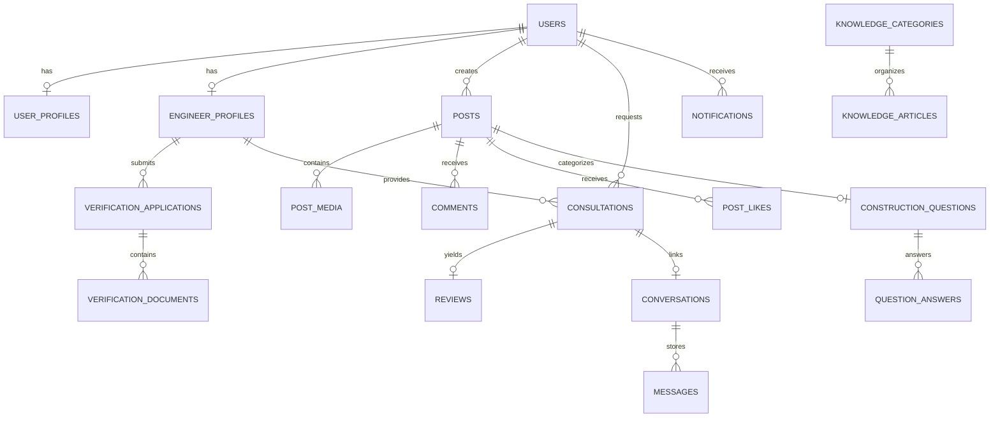

# BuildLink Database Design & Schema Specification

**Database Engine:** Microsoft SQL Server 2025 Express Edition  
**ORM:** TypeORM (Driver: `mssql`)  
**Character Encoding:** NVARCHAR / UTF-16 (SQL Server standard with full Unicode & Sinhala/Tamil script support)

---

## 1. Domain Entities & Schema Overview

BuildLink's database is structured into 8 cohesive logical domains:

---

## 2. Table Specifications

### 2.1 Identity & Profiles
- `users`: `id (UUID)`, `email (NVARCHAR UNIQUE)`, `password_hash (VARCHAR)`, `role (VARCHAR: USER, ENGINEER, ADMIN)`, `status (VARCHAR: ACTIVE, SUSPENDED, PENDING)`, `email_verified (BIT)`, `created_at`, `updated_at`.
- `user_profiles`: `id (UUID)`, `user_id (FK)`, `first_name`, `last_name`, `display_name`, `avatar_url`, `bio`, `city`, `district`, `phone_number`, `created_at`, `updated_at`.
- `engineer_profiles`: `id (UUID)`, `user_id (FK UNIQUE)`, `title`, `specializations (NVARCHAR JSON/delimited)`, `years_of_experience (INT)`, `registration_body (NVARCHAR)`, `registration_number (NVARCHAR)`, `verification_status (VARCHAR: NOT_SUBMITTED, PENDING_REVIEW, UNDER_REVIEW, VERIFIED, REJECTED, SUSPENDED)`, `consultation_fee (DECIMAL)`, `available_for_consultation (BIT)`, `rating_average (DECIMAL)`, `rating_count (INT)`.

### 2.2 Professional Verification
- `verification_applications`: `id (UUID)`, `engineer_profile_id (FK)`, `submission_date`, `status`, `reviewer_notes`, `reviewed_by (FK users)`, `reviewed_at`.
- `verification_documents`: `id (UUID)`, `application_id (FK)`, `document_type`, `file_url`, `original_filename`, `is_verified (BIT)`, `created_at`.

### 2.3 Social Community & Q&A
- `posts`: `id (UUID)`, `author_id (FK users)`, `post_type (VARCHAR: GENERAL, QUESTION, PROJECT_UPDATE, TIP)`, `category (VARCHAR)`, `title (NVARCHAR)`, `content (NVARCHAR MAX)`, `likes_count (INT)`, `comments_count (INT)`, `is_resolved (BIT)`, `created_at`, `updated_at`.
- `post_media`: `id (UUID)`, `post_id (FK)`, `media_url`, `media_type (VARCHAR)`, `display_order (INT)`.
- `post_likes`: `id (UUID)`, `post_id (FK)`, `user_id (FK)`, `created_at` — **Unique constraint on `(post_id, user_id)`**.
- `comments`: `id (UUID)`, `post_id (FK)`, `author_id (FK)`, `parent_comment_id (FK nullable)`, `content (NVARCHAR MAX)`, `is_professional_answer (BIT)`, `is_marked_helpful (BIT)`, `created_at`.

### 2.4 Consultations & Reviews
- `consultations`: `id (UUID)`, `client_id (FK users)`, `engineer_id (FK engineer_profiles)`, `consultation_type (VARCHAR: TEXT, AUDIO, VIDEO, ONSITE)`, `status (VARCHAR: REQUESTED, ACCEPTED, DECLINED, SCHEDULED, COMPLETED, CANCELLED)`, `scheduled_at (DATETIMEOFFSET)`, `problem_description (NVARCHAR MAX)`, `created_at`, `updated_at`.
- `reviews`: `id (UUID)`, `consultation_id (FK UNIQUE)`, `client_id (FK users)`, `engineer_id (FK engineer_profiles)`, `rating (INT: 1-5)`, `comment (NVARCHAR MAX)`, `created_at` — **Enforces 1 review per completed consultation**.

### 2.5 Knowledge Hub & Administration
- `knowledge_categories`: `id (UUID)`, `slug (VARCHAR UNIQUE)`, `title (NVARCHAR)`, `description (NVARCHAR)`, `display_order (INT)`.
- `knowledge_articles`: `id (UUID)`, `category_id (FK)`, `title (NVARCHAR)`, `slug (VARCHAR UNIQUE)`, `summary (NVARCHAR)`, `content (NVARCHAR MAX)`, `cover_image_url`, `author_id (FK users)`, `is_published (BIT)`, `published_at`, `created_at`.
- `audit_logs`: `id (UUID)`, `actor_id (FK users nullable)`, `action (VARCHAR)`, `target_type (VARCHAR)`, `target_id (VARCHAR)`, `details (NVARCHAR MAX)`, `ip_address`, `created_at`.

---

## 3. SQL Server Express Resource Optimization
- Store file metadata (paths/URLs) in SQL Server tables rather than BLOBs inside tables to respect SQL Server Express's 10GB database size limit.
- Apply non-clustered indexes on frequently filtered foreign keys (`user_id`, `post_id`, `engineer_id`) and status columns.
- Use `DATETIMEOFFSET` for time-zone aware scheduling.
